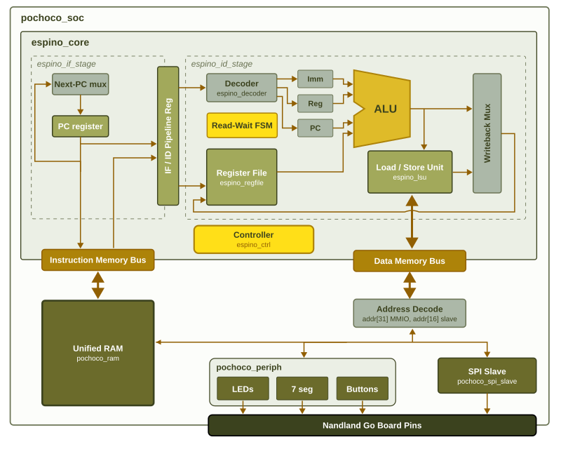

# Proyecto 4: Pochoco Trader

Agente de inversión que corre en el Pochoco SoC, con el procesador Espino (RV32E), sobre la Nandland Go Board (iCE40 HX1K, 25 MHz). Una FPGA maestra envía por SPI el precio de una acción en cada tick y el programa responde si compra, vende o mantiene, y cuántas acciones.

Arquitectura de Computadores, Universidad de los Andes, semestre 2026-2. Profesor: Jorge Gómez Mir.

Grupo: Nicolás Araneda, Vicente Calderón y Santiago Muñoz.

El enunciado está en `docs/Proyecto_4_arq.pdf`. El avance del trabajo se registra en `docs/estado.md` y las decisiones de diseño en `docs/decisiones.md`.

## Origen del código

- El punto de partida es el repositorio base del curso, [nic0villegasc/pochoco_soc](https://github.com/nic0villegasc/pochoco_soc), de Nicolás Villegas, importado sin cambios desde su commit `33e8b5a`. Esa copia quedó marcada con la etiqueta `base-curso`. Los archivos del repositorio base conservan su encabezado de autor y su licencia (Solderpad Hardware License 0.51). Cuando modificamos uno de esos archivos, lo indicamos debajo del encabezado original.
- El ensamblador `tools/pochoasm.py` es el que escribió este grupo para el Proyecto 2 y amplió en el Proyecto 3, con el nombre y la interfaz que espera el testbench del Proyecto 4.
- Del Proyecto 3 del grupo vienen también el formato de la traza de `tb/tb_cpi.sv` y el método de comparar trazas ciclo a ciclo.
- El power-on reset largo de `rtl/pochoco_soc.v` también viene de nuestro Proyecto 2.
- `tb/tb_proyecto_4.sv` y `tb/practica.csv` son el testbench y la serie de práctica entregados por el curso. No se modifican.

## Herramientas y versiones

Todo se corre con [OSS CAD Suite](https://github.com/YosysHQ/oss-cad-suite-build), versión del 2026-09-06, sobre Ubuntu (WSL2):

| Herramienta    | Versión                    |
|----------------|----------------------------|
| Yosys          | 0.68+195                   |
| nextpnr-ice40  | 0.11.1-19-g8dbcee5c        |
| Icarus Verilog | 14.0 (devel, s20260301)    |
| Verilator      | 5.053 (devel)              |
| Compilador de C | gcc o clang, cualquiera reciente (para el gemelo digital) |
| Python         | 3.11 o superior            |
| icepack, iceprog | los de OSS CAD Suite     |

No se necesita un toolchain de RISC-V: el ensamblador es propio y está en el repositorio.

Todos los comandos se ejecutan desde la raíz del repositorio.

## Cómo ensamblar `trade.s`

```bash
python3 tools/pochoasm.py sw/trade.s -o sw/trade.hex
```

o `make asm`. La sintaxis que acepta el ensamblador está en `docs/ensamblador.md`, y sus 87 tests se corren con `make test-asm`. `trade.hex` queda relleno con ceros hasta las 512 palabras de la RAM.

El programa está explicado bloque por bloque en `docs/trade_s.md`.

## Cómo correr los testbenches

Testbench oficial, con los mismos comandos de su encabezado:

```bash
python3 tools/pochoasm.py sw/trade.s -o sw/trade.hex
iverilog -g2012 -s tb_proyecto_4 -o /tmp/tb_p4 $(yosys-config --datdir)/ice40/cells_sim.v rtl/*.v rtl/espino_core/*.v tb/tb_proyecto_4.sv
vvp -n /tmp/tb_p4
```

o `make tb`, que hace lo mismo y además falla si el resultado no es 4/4. La corrida por defecto (2000 ticks con período de 0,1 ms) demora cerca de un minuto y medio. El detalle por tick queda en `decisiones.csv`.

Otros objetivos:

| Comando | Qué hace |
|---------|----------|
| `make tb-param PERIODO_NS=1000000 NTICKS=500` | Corre una copia del testbench oficial con otro período y otro número de ticks, y compara el resultado con la referencia. El original no se toca. |
| `make -j4 equiv` | Equivalencia con la referencia: el `decisiones.csv` debe ser idéntico byte a byte al de `ref/trader.py`. Incluye los 20 000 ticks de práctica en el gemelo digital a los tres períodos, los mismos 20 000 ticks por el RTL con Verilator a 0,1 ms y 1 ms, y una serie de cada familia sintética. Es lo que corre la integración continua en cada push. |
| `make equiv-r3` | Los 20 000 ticks a 0,1 ms con Icarus, el simulador del testbench oficial (13 minutos). Es una ejecución manual: no corre en cada push. En GitHub se lanza con `gh workflow run CI -f icarus_completo=true`. |
| `make equiv-largo` | Lo mismo con los 20 000 ticks a 10 ms, con Verilator (unos 25 minutos). |
| `make medir-ticks` | Mediciones por tick del punto 3.2: IC, ciclos, CPI y tiempo, promedio y peor caso, en las tres rondas. Resultado en `docs/mediciones/ticks_software.txt`. |
| `make sim-bitstream` | Simula el bitstream ya ruteado (no el RTL) y comprueba que decide igual que la referencia. |
| `make cosim` | Valida el gemelo digital contra el RTL: trazas idénticas ciclo a ciclo, programas aleatorios y testbench oficial. |
| `make equiv-gemelo` | Corre `trade.hex` en el gemelo sobre las 3810 series del protocolo, a los tres períodos, y lo compara con la referencia. |
| `make test-candidatos` | Pruebas de la familia paramétrica de estrategias: el motor en C coincide con la referencia en Python, las familias calibradas son reproducibles. |
| `make algoritmo` | Todo el estudio del algoritmo: ajuste del generador, política óptima, una tabla por idea, experimentos y candidatos. Deja las salidas en `docs/mediciones/` (unos 3 minutos). |
| `make cpi` | Mide instrucciones, ciclos y CPI del core con `tb/tb_cpi.sv`, y comprueba el modelo de costo. Corrida corta, con precios de un LFSR. |
| `make check` | Tests del ensamblador y de la referencia, `trade.hex` al día y testbench oficial. |
| `make tb-mv2x2` y `make costo-mv2x2` | Producto 2x2 en punto fijo (solo diseño y costo): compara las versiones de hardware con su modelo y mide LUT en la FPGA y área en GF180. Resultado en `docs/mediciones/mv2x2_costo.txt`. |

## Cómo correr la versión de referencia del algoritmo

```bash
python3 ref/trader.py tb/practica.csv                    # tabla: algoritmo contra no operar y comprar y mantener
python3 ref/trader.py tb/practica.csv -o build/ref.csv   # decisiones.csv de referencia
make test-ref                                            # pruebas del mercado y de la referencia
```

- `ref/trader.py` es la referencia oficial del algoritmo. Hace las cuentas con las mismas operaciones que `sw/trade.s`.
- `ref/market.py` es el mercado de la maestra, portado de la tarea `ejecutar` del testbench. `python3 ref/market.py validar decisiones.csv` rehace la contabilidad de una corrida del testbench y exige que coincida fila por fila.
- `ref/p4_baseline.py` y `ref/hallazgos.py` (`make hallazgos`) son el punto de partida y el análisis estadístico de la serie de práctica.

Resultado de la regla base sobre la serie de práctica completa (20 000 ticks, viendo todos los precios):

| Estrategia | Patrimonio final | Órdenes | Comisiones | Pérdida máxima |
|------------|------------------|---------|------------|----------------|
| No operar | 10 000 | 0 | 0 | 0 |
| Comprar y mantener | 6 497 | 1 | 5 | |
| Regla base (`trade.s`) | 27 062 | 388 | 1 940 | 2 929 |

## Piezas avanzadas

Cada una tiene su documento de estudio, su prueba y el número que la respalda.

| Pieza | Qué es | Cómo se corre su prueba | Número que la respalda | Documento |
|-------|--------|-------------------------|------------------------|-----------|
| Gemelo digital | Simulador en C del SoC con exactitud de ciclo. Corre el mismo `trade.hex` del bitstream. | `make cosim` | Traza idéntica al RTL en 8 configuraciones, más de un millón de eventos. 20 000 ticks a 10 ms en 0,02 s (Verilator: 22 minutos). | `docs/gemelo.md` |
| Protocolo de evaluación | 10 bloques de práctica, 1000 remuestreos y 14 familias sintéticas calibradas (plausibles y de estrés), con criterio de aceptación. | `make protocolo` y `make equiv-gemelo` | Regla base: media 10 772 y percentil 5 de 8 914 en los remuestreos. El binario coincide con la referencia en 23 millones de ticks. | `docs/protocolo.md` |
| Modelo del generador y candidatos | Modelo de nivel, transitoria y redondeo ajustado a la serie de práctica; política óptima; guardia de régimen y tope de pérdida; candidatos sobre la frontera entre media y percentil 5. El algoritmo de la placa sigue siendo la regla base hasta elegir. | `make algoritmo` y `make test-candidatos` | Techo del modelo: 8,4 % por ronda. Mejor candidato: 0,7 % sobre la regla base en remuestreos y 1,4 % en las familias plausibles, con semilla reservada. | `docs/algoritmo.md` |
| Simulación del bitstream | Simula lo que se graba en la placa, reconstruido desde el `.asc`. | `make sim-bitstream` | 2000 ticks idénticos a la referencia. | `docs/decisiones.md`, T15 |
| Programas aleatorios | Generador de programas para comparar dos modelos del SoC. | `make cosim` | 469 343 escrituras de registro y de memoria comparadas con 4 semillas. | `docs/gemelo.md`, sección 3 |
| Producto 2x2 en punto fijo (diseño y costo) | Instrucción propuesta `kal2`: un paso del filtro de Kalman de dos estados como producto de matriz 2x2 por vector, con el estado empaquetado en dos carriles de 16 bits. No está en el SoC. | `make tb-mv2x2` y `make costo-mv2x2` | Tres implementaciones idénticas al modelo en 20 000 vectores por matriz. Coeficientes fijos: 251 LUT con los coeficientes calibrados, agrega 328 celdas al SoC y no cabe. Multiplicadores reales: 3094 LUT en la FPGA, 124 000 um² en GF180. | `docs/producto_2x2.md` |

## Cómo sintetizar y programar la placa

```bash
make bin             # yosys, nextpnr e icepack: deja build/pochoco_soc.bin
make sim-bitstream   # opcional: simula el bitstream y lo compara con la referencia
make prog            # iceprog build/pochoco_soc.bin, con la Go Board conectada por USB
```

`make bin` ensambla `sw/trade.s` si hace falta y deja el programa dentro del bitstream. El resumen de celdas, BRAM y frecuencia máxima queda en `build/nextpnr.log`.

Los bitstreams ya probados están en `bitstreams/`, con su hash y las pruebas que pasó cada uno. Para grabar uno de esos: `iceprog bitstreams/competencia_v1.bin`.

## Mediciones del repositorio base

```bash
make medir-base
```

Extrae la copia sin cambios del repositorio base (etiqueta `base-curso`) y mide celdas lógicas, BRAM, frecuencia máxima con 10 semillas, el costo de habilitar el shifter completo, si el encapsulado acepta un PLL y el CPI en simulación. El resultado queda en `docs/mediciones/base.txt`.

## Estructura

| Carpeta    | Contenido |
|------------|-----------|
| `rtl/`     | Pochoco SoC y Espino Core. |
| `sw/`      | `trade.s` y los programas de ejemplo del repositorio base. |
| `tb/`      | Testbench oficial, serie de práctica y testbenches propios. |
| `ref/`     | Referencia del algoritmo en Python, mercado de la maestra, series de prueba, protocolo de evaluación y gemelo digital. |
| `tools/`   | Ensamblador, generador de programas aleatorios y scripts de equivalencia, co-simulación y medición. |
| `bitstreams/` | Bitstreams de competencia, con su hash. |
| `formal/`  | Verificación formal (todavía vacía). |
| `docs/`    | Enunciado, estado, decisiones, documentación y mediciones. |
| `informe/` | Informe en LaTeX (todavía vacío). |

## Mapa de memoria

| Dirección     | Registro | Uso |
|---------------|----------|-----|
| `0x0000_0000` | RAM unificada de 512 palabras | Instrucciones y datos. |
| `0x8000_0000` | Displays de 7 segmentos | Escritura. |
| `0x8000_0004` | LEDs | Escritura. |
| `0x8000_0008` | Interruptores | Lectura. |
| `0x8001_0000` | `STATUS` del SPI | Bit 0: hay un precio nuevo. Bit 1: `CS_n` activo. |
| `0x8001_0004` | `PRICE` | Último precio recibido. Leerlo baja la bandera de precio nuevo. |
| `0x8001_0008` | `DECISION` | Byte que la maestra lee en la transacción siguiente. |


